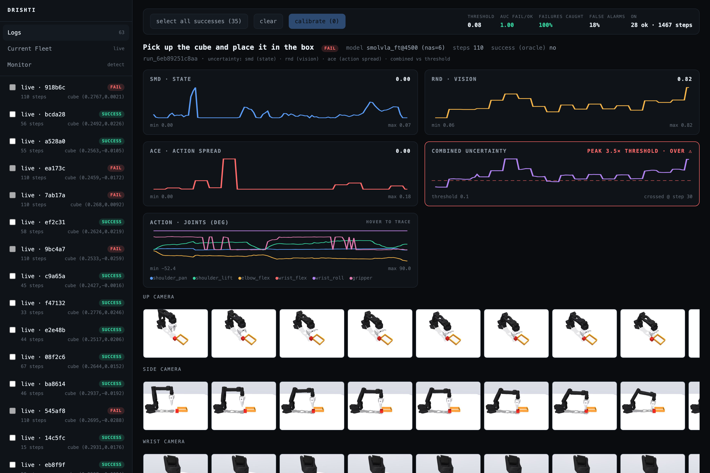
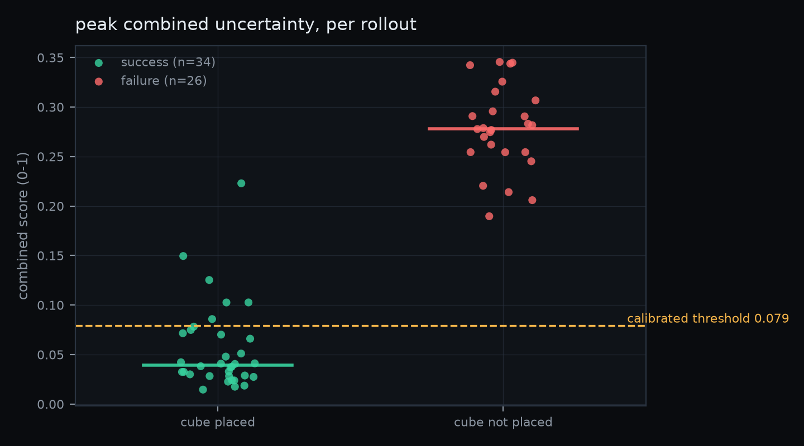
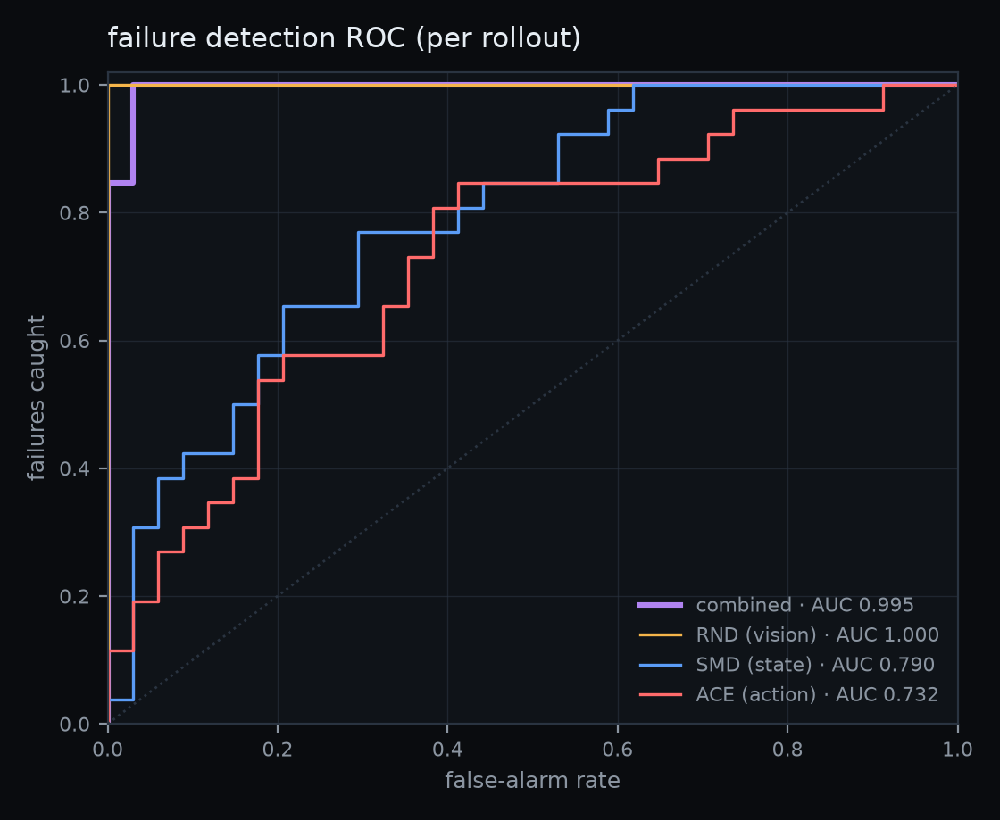
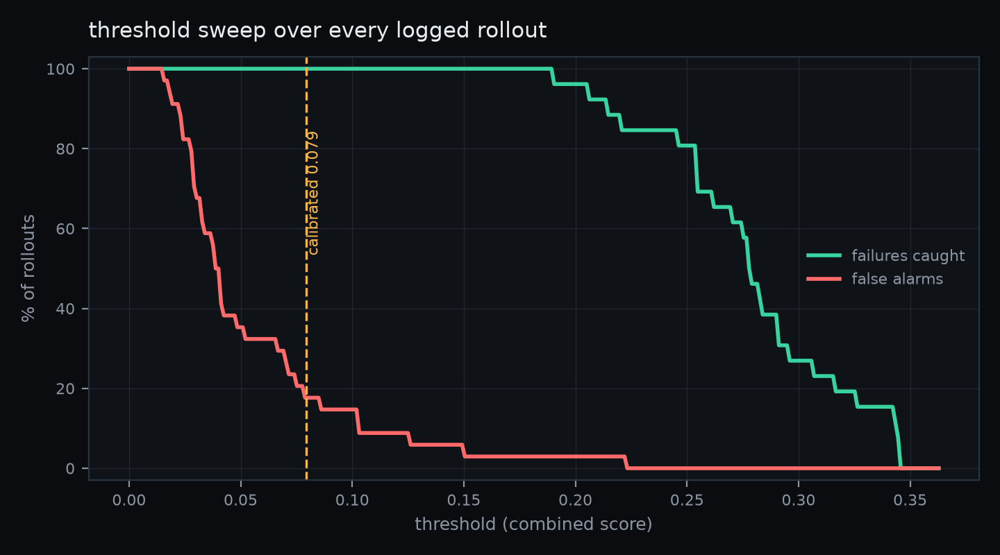
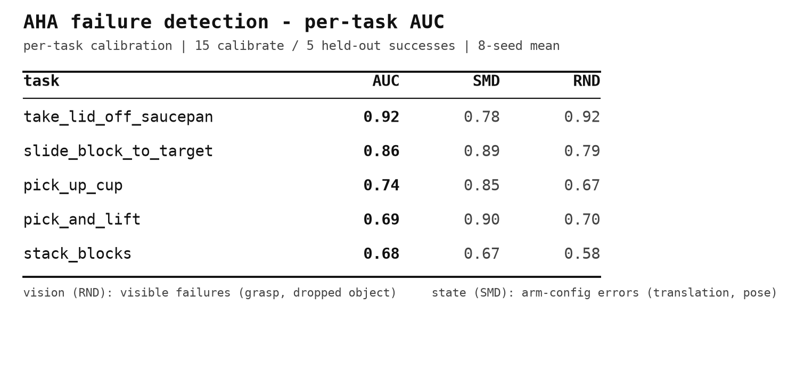
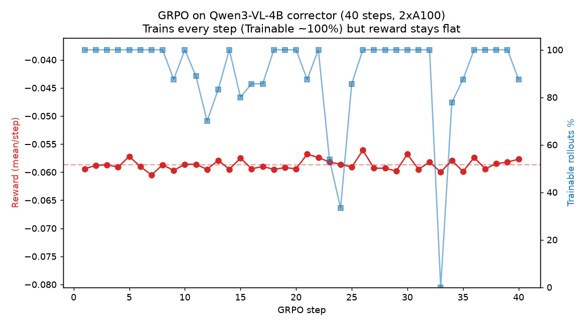

<h1 align="center">drishti</h1>

<p align="center">
  <b>Catch a robot policy failing — while it is still failing, not after.</b><br>
  A runtime uncertainty and failure-detection layer for vision-language-action models.
</p>

<p align="center">
  <a href="https://github.com/Advaitic/drishti/actions/workflows/ci.yml"></a>
  <a href="LICENSE"></a>
  
  <a href="docs/results/calibration/report.json"></a>
  
</p>

> [!IMPORTANT]
> **This is a research preview, under active development.** It is a lab notebook that happens to
> compile: the code runs and every number below is backed by an artifact in this repo, but the
> results are small-*n*, mostly in simulation, and one whole study here is a **negative result**.
> Nothing here is production-safety software, and it has never run on a robot that could hurt
> anyone. Read [what is and isn't true](#what-is-and-isnt-true) before you trust a number.

---

A robot policy is a neural network that looks at camera frames and emits motor commands. Like any
network it sometimes fails, and unlike most networks a failure means something moves in the world.
Running the policy is the easy part. The hard part is knowing **when to stop trusting it** — ideally
before the gripper closes on nothing and the arm carries air to the tray.

drishti watches a policy from the inside while it runs. A forward hook pulls the vision encoder's
embedding and the action head's output on every inference; three cheap detectors score how far each
of those is from what "working" looked like; a calibration step turns those scores into one number
and one threshold. When the number crosses the threshold you have a failure prediction, with the
frames and the joint trace attached to it.

On our SO-101 pick-place task that separates the 26 rollouts that failed from the 34 that succeeded
at **AUC 0.995**, catching **100% of failures** at a **17.6% false-alarm rate**. Moved to a
different arm, a different simulator and a different failure-generation process, the same detectors
still get 0.68–0.92 per task. Both numbers, their caveats, and an honest negative from a third study
are below.

<p align="center">
  
  <br><em>A failed rollout, replayed. Combined uncertainty crosses the calibrated threshold at step 30 — the arm still has 80 frames to run.</em>
</p>

---

## Contents

- [Try it in 60 seconds](#try-it-in-60-seconds)
- [How it works](#how-it-works)
- [Results](#results)
- [Point it at your own robot](#point-it-at-your-own-robot)
- [What is and isn't true](#what-is-and-isnt-true)
- [Repo map](#repo-map)
- [Research this builds on](#research-this-builds-on)
- [Contributing](#contributing) · [Citing](#citing) · [License](#license)

---

## Try it in 60 seconds

No GPU, no model download, no dataset to fetch, and — for the dashboard — no torch. The repo ships
63 recorded rollouts.

```bash
git clone https://github.com/Advaitic/drishti && cd drishti
python -m venv .venv && source .venv/bin/activate
pip install -e .                   # five small packages
drishti demo                       # → http://127.0.0.1:8010
```

Open it, click any rollout in the sidebar, read the four traces. Successes stay flat under the
dashed line; failures climb over it. Then reproduce the headline number yourself — this one needs
the detectors, so it pulls torch:

```bash
pip install -e '.[uq]'
drishti calibrate --demo --auto    # refits the detectors on the successful rollouts
```

That prints a validation report identical to
[`docs/results/calibration/report.json`](docs/results/calibration/report.json) — the file every
number in this README comes from. Calibration is seeded, so it reproduces exactly, and
[`tests/test_demo_bundle.py`](tests/test_demo_bundle.py) fails the build if it ever stops matching.

<details>
<summary><b>More than the demo</b></summary>

```bash
pip install -e '.[all]'               # sim + detectors + encoders + RL env + test deps
pytest -q                             # the full suite: no network, no weights, no GPU

python -m drishti.sim.scripted_pick   # scripted pick-and-place in MuJoCo, prints success
drishti record --episodes 20          # record your own rollouts into data/demos/
drishti figures --demo                # regenerate the figures in assets/figures/
```

Extras: `sim` (MuJoCo scene), `uq` (detectors + calibration + figures), `embed` (SigLIP/DINOv2),
`policy` (LeRobot + a real VLA), `rl` (the `verifiers` environment), `dev` (pytest).

The server binds `127.0.0.1` deliberately — it runs subprocesses on request and has no
authentication. Don't put it on a network.
</details>

---

## How it works

```
   your policy ──► forward hooks ──► vision embedding + action-head output
        │                                        │
        │ actions                                ▼
        ▼                              ┌─────────────────────┐
   robot / sim ───► joint state ──────►│  SMD · RND · ACE    │   three detectors
        │                              └──────────┬──────────┘
        │ frames                                  │
        ▼                                         ▼
   telemetry spine ────────────────────►  combine + calibrated threshold
   (sdk → store → server)                         │
        │                                         ▼
        └──────────────► dashboard ◄──── "this rollout is going wrong, at step 30"
```

**Three detectors, because failures are not all the same shape.** A cascade — cheap to expensive,
each blind to what the others see:

| | what it asks | what it reads | needs calibration? | our AUC |
|---|---|---|---|---|
| **SMD** | *is the arm in a pose good rollouts never visit?* | the 6 joint angles | yes | 0.79 |
| **RND** | *does the scene look off-manifold?* | the pooled vision embedding, all 3 cameras | yes | **1.00** |
| **ACE** | *is the policy itself unsure what to do next?* | the action head's spread | no | 0.73 |

- **SMD** is Mahalanobis distance on the proprioceptive state — a z-score that accounts for how the
  joints co-vary. Nearly free, and it fires when the arm ends up somewhere strange.
- **RND** is [random network distillation](https://arxiv.org/abs/1810.12894) on the vision
  embedding: train a small network to imitate a frozen random one on embeddings from successful
  rollouts, and the prediction error becomes a novelty score. This is the one that reaches *inside*
  the model, and the one that does the work. The biggest single lever on its quality turned out to
  be whitening the input — the raw SigLIP dimensions have wildly different scales, and standardizing
  them moved our ablation from AUC 0.58 to ~1.0.
- **ACE** is the policy's own uncertainty, read straight off the action head, and the only one that
  says anything before you have calibrated. It is also the weakest here — see the caveats.

**Calibration is the part people skip.** SMD and RND are defined *relative to normal*, so they have
nothing to say until they have seen normal. [`drishti/calibrate.py`](drishti/calibrate.py) fits them
on the rollouts that succeeded, then normalizes and combines the three signals with a rule that took
several wrong turns to arrive at — [`drishti/scoring.py`](drishti/scoring.py) explains each one:

- **mean of capped-z, not max.** `max` fires on whichever detector is loudest, so one grazing
  detector is a false alarm. The mean is agreement-aware.
- **a ceiling of 32σ, not 8.** At 8, held-out successes *and* failures both saturate to 1.0 and the
  separation vanishes — held-out AUC 0.78 at 8, 0.99 at ≥32.
- **the 90th percentile of per-rollout peaks, not of steps.** Bounding steps at the 95th percentile
  sounds tight until you notice that over a ~50-step rollout, 5% of steps compounds to ~73% of
  rollouts grazing at least once. What you want to bound is per-rollout.
- **score at serve cadence.** Calibrating only on inference frames while serving every frame is
  train/serve skew: mid-chunk poses the calibration never saw spike SMD, and every live rollout
  false-alarms.

The longer version, with every term defined: [**docs/LEARNINGS.md**](docs/LEARNINGS.md).

---

## Results

### 1. Uncertainty separates success from failure — SO-101 pick-place, SmolVLA

<p align="center">
  
  
</p>

63 recorded rollouts of a finetuned SmolVLA, 60 of which carry the vision embeddings the detectors
need (34 success / 26 failure). Success is labelled by a deterministic geometric oracle — in
simulation we know exactly where the cube is, so it is ground truth rather than a judgement call.

| | |
|---|---|
| Combined AUC (failure vs success) | **0.995** |
| Failures caught | **100%** (26/26) |
| False alarms at the calibrated threshold | 17.6% (6/34) |
| Mean warning before the rollout ends | 99 steps |
| Per-detector AUC | RND **1.00** · SMD 0.79 · ACE 0.73 |



The calibrated threshold is deliberately conservative: it is a *conformal* bound chosen without
looking at a single failure, so that a new successful rollout trips it roughly 10% of the time. If
you are willing to look at failures, the sweep on the right finds a better operating point —
anywhere in **0.15–0.19** still catches all 26 failures and produces exactly **one** false alarm
(2.9%). Which of those you want is a deployment question, not a research one, and the dashboard's
Monitor tab has the slider.

Reproduce: `drishti calibrate --demo --auto`.

<br clear="right">

### 2. It transfers to another robot and another simulator — the AHA benchmark

Does any of this survive leaving our own sandbox? We ran the same SMD + RND detectors on
[NVlabs' AHA](https://aha-vlm.github.io/) — a **Franka Panda** (not SO-101), in
**CoppeliaSim/RLBench** (not MuJoCo), with failures **procedurally injected by FailGen** (not organic
policy failure).

<p align="center">
  
</p>

Uniform 0.68–0.92 across five tasks, held out, no inversions. Getting there produced the more useful
findings: **calibrate per task, not pooled** (the biggest single lever); **DINOv2 beats SigLIP** as
the RND encoder here; **temporal windowing** is what rescues the `wrong_sequence` failure mode
(0.57 → 0.91), because a step that is individually valid but out of order has no per-frame
footprint; and force/touch channels are **not** the missing piece for grasp detection — vision is.

An earlier, data-starved run of the same five tasks gave 0.22–0.82 with a degenerate threshold. We
kept that write-up and marked it superseded rather than deleting it, because the failure mode —
seven calibration successes is not enough to fit a Gaussian — is the most transferable lesson in the
study. Full write-up: [**docs/aha/SUMMARY.md**](docs/aha/SUMMARY.md).

> These AUCs are **not comparable** to the 1.00 above. AHA is two-detector (no policy in the loop,
> so no action head, so no ACE) and held out; the SO-101 RND figure is single-detector and
> in-sample. AHA also tests *detection* of injected perturbations, not *anticipation* of a policy
> about to fail on its own — a genuinely different question.

### 3. The negative result: VLAs are not steerable by language



The obvious next move after "we can detect failure" is "so correct it." We built the whole thing:
when calibrated uncertainty spikes, a Qwen3-VL corrector sees the failure frames and emits a new
instruction; the VLA resumes; task success is the reward; train the corrector with GRPO. The
infrastructure worked end to end on a 2×A100 pod — reward → advantages → LoRA update, on a real VLM
supervising a real VLA in a live sim loop.

**And the reward never moved.** Two decisive follow-up tests explain why: the finetuned VLA — and the
base checkpoint too — is essentially **deaf to language**. Opposite instructions move the predicted
action by about **0.02° per joint**. It had been finetuned on one fixed instruction string applied
identically to every frame, so vision and proprioception alone determined every action, and there
was never gradient pressure to attend to the words.

We then tested the obvious fix — relabelling the demos with time-varying sub-goal captions, and
separately a LoRA making the language backbone itself trainable — on a rebuilt 150-episode dataset.
**Both negative**, at 0.00–0.01°/joint. A closed-loop success check hinted at +15–20 points before
collapsing to noise at n=60 per condition. Our current read: temporal caption variation is not
enough, because each caption's time window still maps to a fully vision-determined state, so
language stays *redundant* with vision. Making it necessary probably requires genuinely
action-divergent instructions — the same scene with two valid targets and only the words to choose
between them.

Every error, dead end and pod misadventure is written down:
[**RESULTS.md**](docs/rl-corrector/RESULTS.md) for the positive record,
[**DEBUG_LOG.md**](docs/rl-corrector/DEBUG_LOG.md) for the ~30 things that went wrong.

<br clear="right">

---

## Point it at your own robot

The detectors know nothing about SO-101, MuJoCo, or pick-and-place. What they need is a policy you
can hook, a state vector, and a success label. Everything else here is scaffolding for *our* robot
that you are free to throw away.

**Instrument a policy — this is the whole API.**

```python
import drishti

run = drishti.start_run("my-policy", "pick up the red block",
                        ingest_url="http://localhost:8010")
policy = drishti.instrument(policy)           # registers the forward hooks

for t, obs in enumerate(stream):
    with run.step(step_idx=t) as step:        # hooks attribute to this step
        action = policy.select_action(obs)    # your inference, unchanged
        step.log_observation(state).log_action(action)

run.finish(success_rate=1.0 if placed_it else 0.0)
```

`instrument()` looks for the vision encoder and action head by name, then falls back to a generic
locator — any module matching `vision|backbone|siglip|dino|…`, then the last `Linear` projecting to
the action dimension — so it works on VLAs it has never seen. Hooks never raise into your model: if
one fails you lose a signal, not a rollout. Telemetry leaves on a background thread, and the `step`
context manager returns in microseconds.

**Then the flywheel is three commands:** record rollouts → `drishti calibrate --auto` → watch the
Monitor. Successes feed the next calibration.

**What you will have to change:**

| If your setup differs | Change this |
|---|---|
| Different robot or simulator | Write your own env. Nothing in `drishti/uq/` or `drishti/hooks.py` knows about SO-101 |
| Different policy family | Usually nothing — `instrument()` auto-locates. Check `step.internals` is populated |
| No deterministic success oracle | This is the real constraint. You need *some* ground-truth label to calibrate against |
| Different task length | `MIN_CALIB_STEPS` in `drishti/calibrate.py`, which drops implausibly short "successes" |
| Different cameras | Whatever the hook sees gets pooled and concatenated. More views helped us: 1 cam AUC 0.58, 3 cams 0.81 |
| A real robot, not sim | Untested. See the limitations below — we mean it |

The detectors themselves are ~160 lines total, deliberately readable:
[`drishti/uq/`](drishti/uq/).

---

## What is and isn't true

The most useful thing a research repo can publish is the boundary of its own claims.

**Small *n*, and the headline is in-sample.** 60 scored rollouts, one task, one arm, one policy. RND is fit
on the same successful rollouts it is then scored against, so its AUC of 1.00 is in-sample and will
soften on held-out data. The AHA study, which *is* held out, lands at 0.68–0.92 — probably closer to
what a new setup should expect.

**Simulation only, for the detection results.** The success oracle is a geometric check on the
cube's true position, which is exactly the thing you do not have on a real robot. Everything
downstream of "we know which rollouts failed" inherits that assumption.

**ACE, as implemented, is weak.** It reads the spread of a single forward pass, which for our
finetuned SmolVLA is nearly constant. The principled version — sample N action chunks from the same
observation and measure their disagreement — is implemented in
[`drishti/uq/ace.py`](drishti/uq/ace.py), but it costs N× inference, so it is not the default.

**The "99 steps of warning" is early, not prescient.** Every failure in this set runs to the
110-step cap, so a 99-step mean lead means the score is over threshold within roughly the first ten
frames. These are rollouts that go wrong at the *approach* — a doomed trajectory caught early, not a
late subtle slip called in advance. The same pattern showed up harder in the MolmoAct2 study, where
RND flagged from about frame 0; the likely reading there is that it keys on the initial cube
position and failures cluster on hard placements that look out-of-distribution immediately. Useful
either way, but it is not the same claim as "we watched the failure develop."

**One study is a clean negative** and is reported as one, twice over. If your plan depends on
steering a VLA with language, read [§3](#3-the-negative-result-vlas-are-not-steerable-by-language)
before spending GPU hours.

**Not safety software.** No formal guarantees, no hardware interlock, no real-robot validation. A
conformal threshold bounds false alarms on *successful rollouts drawn from the same distribution* —
a much weaker statement than "it will catch a dangerous failure."

Where a number has no artifact in this repo, the document that states it says so.

---

## Repo map

```
drishti/            the package
  sdk.py            start_run / run.step — what you call
  hooks.py          forward hooks: vision embedding + action head, per step
  uq/               the detectors — smd.py · rnd.py · ace.py · embed_frames.py
  scoring.py        the combine rule, in one place, with the reasoning
  calibrate.py      fit on successes → threshold + validation report
  server/app.py     FastAPI: ingest, query, live-tail WebSocket, serves the dashboard
  store.py          SQLAlchemy over SQLite (Postgres-ready) + a blob dir
  sim/              MuJoCo SO-101 env, scripted pick-place, IK, rollout server
  drivers/          runnable experiments — live monitor, recorders, probes
  figures.py        regenerates the calibration figures from the report
  cli.py            the `drishti` command

web/dashboard.html  the whole UI: one file, no build step, no dependencies
sim/so101/          vendored SO-101 MJCF + meshes (see its README for provenance)
environments/       `vla-corrector`, a standalone `verifiers` RL environment
scripts/            research tooling: AHA harness, dataset build, finetune, pod setup
configs/rl/         prime-rl GRPO configs
data/demo/          the 63 bundled rollouts that make all of the above runnable
docs/               the write-ups — start at docs/README.md
tests/              22 tests: no network, no weights, no GPU
```

---

## Research this builds on

drishti is an engineering synthesis, not a new method. The detector cascade follows **FIPER** (RND on
policy embeddings + action-chunk entropy + conformal calibration on successful rollouts only); the
state-space Mahalanobis detector follows **ReconVLA**; the conformal framing follows
**FAIL-Detect**; the transfer benchmark is **NVlabs' AHA**. The full reading list, with what each
paper contributed and where it shows up in the code:
[**docs/REFERENCES.md**](docs/REFERENCES.md).

## Contributing

This is a research codebase with a small team behind it, so **bug reports and reproduction failures
are far more useful to us than feature PRs**. If a number here doesn't reproduce on your machine,
that is the single most valuable issue you can file. See [CONTRIBUTING.md](CONTRIBUTING.md).

## Citing

If drishti or its findings are useful in your work, see [CITATION.cff](CITATION.cff), or use the
"Cite this repository" button on GitHub.

## License

[Apache-2.0](LICENSE). Third-party assets — the SO-101 meshes and MJCF, the contact-solver recipe,
the reference camera frames — are attributed in [NOTICE](NOTICE).

Built with [LeRobot](https://github.com/huggingface/lerobot), [MuJoCo](https://mujoco.org),
[SmolVLA](https://huggingface.co/lerobot/smolvla_base), [MolmoAct](https://allenai.org),
[verifiers](https://github.com/willccbb/verifiers) and
[prime-rl](https://github.com/PrimeIntellect-ai/prime-rl). SO-101 hardware by
[TheRobotStudio](https://github.com/TheRobotStudio/SO-ARM100).

<p align="center"><sub>A research project from <b>Advaitic</b>.</sub></p>
